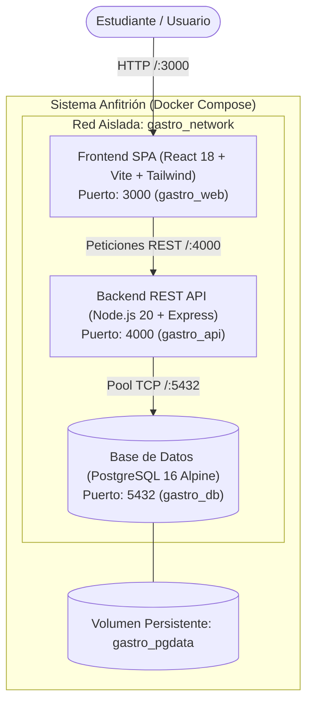

# GastroProyect

**Herramienta de Software para Administración de Insumos y Automatización de Costos y Precios de Venta Gastronómicos**  
*Universidad Autónoma de Zacatecas (UAZ) — Equipo: Morelosoft International Solutions*  
*Estándar de Calidad:* **ISO/IEC 29110-5-1-1:2025**

---

## 1. Resumen de la Arquitectura Base
El sistema adopta una **Arquitectura Cliente-Servidor Desacoplada Multicapa**, orquestada y contenerizada mediante **Docker Compose**. Esto garantiza portabilidad total entre entornos de desarrollo (Linux, macOS, Windows) y trazabilidad completa con los acuerdos y casos de uso aprobados en el Plan de Proyecto.



---

## 2. Estructura del Repositorio

```text
Gastro/
├── docker-compose.yml       # Orquestador multi-contenedor (db, api, web)
├── .env.example             # Plantilla de variables de entorno
├── .env                     # Variables de entorno locales
├── .gitignore               # Reglas de exclusión de Git
├── GEMINI.md                # Reglas y estándares del equipo Morelosoft
├── README.md                # Este documento maestro
├── db/                      # Scripts DDL y semillas de inicialización de PostgreSQL
│   └── init/
│       ├── 01-init-schema.sql  # DDL completo (tablas, restricciones, índices)
│       └── 02-seed-data.sql    # Unidades de medida, categorías y datos iniciales
├── backend/                 # Código fuente y Dockerfile del servicio API REST
│   ├── Dockerfile.dev
│   ├── package.json
│   └── src/
│       ├── config/          # Configuración del pool de conexión PostgreSQL (db.js)
│       ├── routes/          # Rutas REST (health.routes.js, index.js)
│       └── index.js         # Bootstrap de Express
├── frontend/                # Código fuente y Dockerfile de la aplicación cliente SPA
│   ├── Dockerfile.dev
│   ├── package.json
│   ├── vite.config.js
│   ├── tailwind.config.js
│   └── src/
└── docs/                    # Documentación formal de arquitectura y trazabilidad
    ├── arquitectura.md      # Especificación arquitectónica y topología
    ├── database_schema.md   # Diccionario de datos, ERD y reglas de cálculo
    ├── database_schema.mmd  # Código fuente Mermaid del ERD
    ├── database_schema.sql  # Copia de referencia del DDL SQL
    ├── trazabilidad_iso29110.md # Matriz de trazabilidad 100% CUs vs Modelo vs Arqui
    └── SDS.md               # Software Design Specification (Sprint 0)
```

---

## 3. Instrucciones de Arranque y Verificación Local

### 3.1 Poner en Marcha la Arquitectura y Base de Datos
Desde la raíz del proyecto (`/home/dark/Documentos/UAZ/Gastro`):

```bash
docker compose up -d
```

### 3.2 Verificar Estado de los Servicios
```bash
docker compose ps
```

### 3.3 Validar la Base de Datos Local
```bash
# Validar conexión y tablas iniciales creadas en PostgreSQL
docker exec -it gastro_db psql -U gastro_user -d gastro_db -c "\dt"

# Consultar unidades de medida iniciales
docker exec -it gastro_db psql -U gastro_user -d gastro_db -c "SELECT symbol, name, unit_type, conversion_factor FROM measurement_units LIMIT 10;"
```

### 3.4 URLs de Acceso Local
- **Frontend SPA:** [http://localhost:3000](http://localhost:3000)
- **Backend API Info:** [http://localhost:4000/](http://localhost:4000/)
- **Backend Healthcheck:** [http://localhost:4000/api/health](http://localhost:4000/api/health)
- **Backend DB Status:** [http://localhost:4000/api/health/db](http://localhost:4000/api/health/db)
- **Base de Datos PostgreSQL:** `localhost:5432` (`gastro_db` / `gastro_user` / `gastro_password`)
