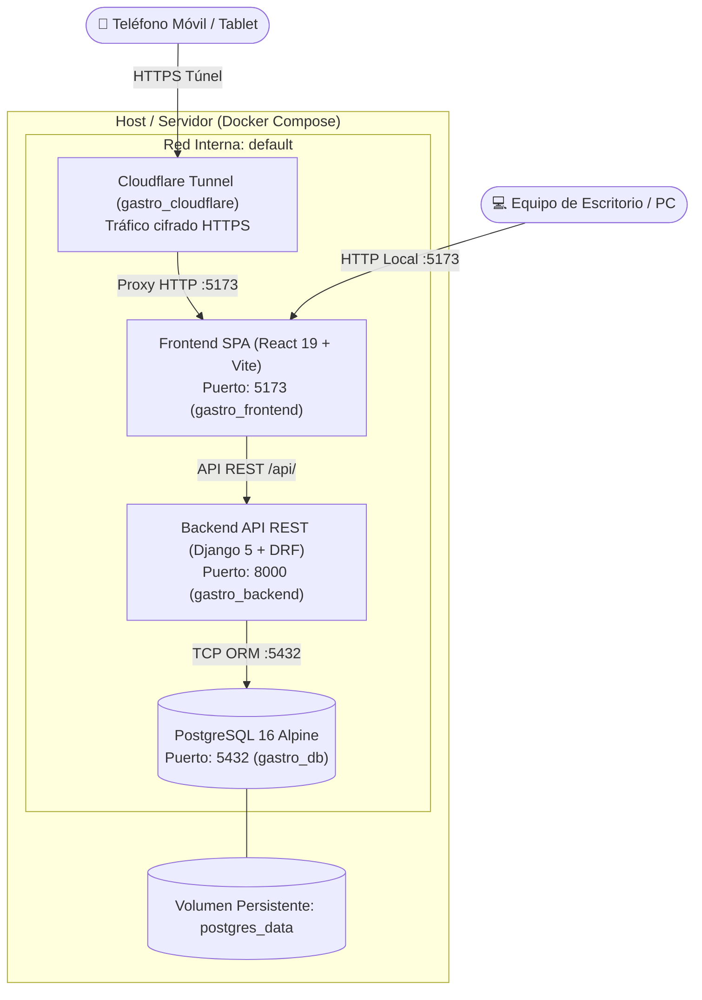

# Atelier Gastronómico 
### Sistema de Administración de Insumos, Fichas Técnicas y Costeo Gastronómico Automatizado

Aplicación web integral diseñada para la carrera de **Gastronomía**, orientada a reemplazar el manejo de hojas de cálculo tradicionales por una plataforma moderna, reactiva y contenerizada. Permite a estudiantes y docentes gestionar catálogos institucionales de ingredientes, calcular mermas y rendimientos, diseñar fichas técnicas estandarizadas y simular escenarios financieros con exportación a PDF de calidad profesional.

---

##  Integrantes del Proyecto
- **Héctor Varela Medina**
- **Karol Christopher Espino Galicia**
- **Carlos Manuel Aguirre Norato**

---

##  Características Principales

- **Fichas Técnicas y Recetario Estandarizado:**
  - Registro de recetas con clasificación (*Entrada*, *Para compartir*, etc.) y tipo (*Estándar* / *Complementaria*).
  - Cálculo automático en tiempo real de **Rendimiento (%)** a partir de Cantidad Neta y Cantidad Bruta.
  - Generación de costos basada en cantidad bruta (contabilizando merma adquirida).
  - Congelamiento de precios unitarios históricos aplicados para auditoría contable.

- **Fijación Financiera y Simulación de Márgenes:**
  - Cálculo instantáneo de **Costo Unitario por porción**.
  - **Precio Sugerido sin IVA** y con IVA (16%) aplicando la fórmula contable gastronómica:
    $$\text{Precio Sugerido} = \frac{\text{Costo Unitario}}{1 - \text{Margen Deseado}}$$
  - Simulación de **Precio de Venta Real con IVA** y cálculo del **Margen Real Bruto obtenido**.
  - Persistencia segura y editable en base de datos.

- **Catálogo de Insumos Institucional:**
  - Registro de materia prima y complementarios con control de empaque y unidad (Kg / Lt).
  - Búsqueda inteligente **insensible a acentos/tildes y mayúsculas** (soporta búsquedas como *Maíz* / *maiz*).
  - Importación y exportación masiva de ingredientes vía archivos **Excel (.xlsx)** con validación estricta de Magic Bytes / encabezados.
  - Protección de integridad referencial: bloqueo o confirmación asistida si se intenta eliminar un ingrediente en uso por recetas activas.

- **Diseño Mobile-First y Experiencia de Usuario:**
  - Totalmente responsivo para teléfonos móviles y computadoras de escritorio.
  - Soporte de gestos táctiles (zoom libre con pellizco de pantalla) y tablas con condensación inteligente.
  - Selector de tema claro y oscuro (Dark / Light mode).
  - Exportación directa a documento **PDF institucional** listo para impresión y entrega académica.

---

##  Stack Tecnológico

| Capa | Tecnología | Descripción |
| :--- | :--- | :--- |
| **Frontend** | React 19 + TypeScript + Vite | SPA moderna con interfaz interactiva, Lucide Icons, jsPDF y autoTable |
| **Backend** | Python 3.12 + Django 5 + Django REST Framework | API REST modularizada (`insumos`, `recetas`, `costeo`, `autenticación`) |
| **Base de Datos** | PostgreSQL 16 Alpine | Motor relacional con integridad transaccional y tipos decimales de alta precisión |
| **Túnel Seguro** | Cloudflare Tunnel (`cloudflared`) | Publicación segura SSL hacia dispositivos móviles sin exponer puertos |
| **Infraestructura** | Docker & Docker Compose | Contenerización orquestada de los servicios para despliegue reproducible |

---

##  Arquitectura del Sistema



---

##  Estructura del Repositorio

```text
├── backend/
│   ├── authentication/     # Endpoints de login, registro y perfil de usuarios
│   ├── config/             # Configuración central Django (settings, urls, wsgi)
│   ├── costeo/             # Modelo y lógica contable del costeo de recetas
│   ├── insumos/            # Catálogo de insumos, importación Excel y filtros
│   ├── recetas/            # Gestión de fichas técnicas e ingredientes
│   ├── Dockerfile          # Contenedor optimizado de backend Django
│   ├── entrypoint.sh       # Migraciones y precarga automática de datos base
│   └── seed_insumos.py     # Semillero con catálogo inicial de ingredientes
├── frontend/
│   ├── src/                # Componentes React, servicios API y estilos CSS
│   ├── public/             # Iconos y recursos estáticos
│   ├── Dockerfile          # Contenedor de frontend con Vite dev server
│   ├── package.json        # Dependencias de frontend
│   └── vite.config.ts      # Configuración de compilador y hot reload (polling)
├── docker-compose.yml      # Definición y orquestación multi-contenedor
├── iniciar.bat             # Script para inicio rápido en Windows
├── ver-link.bat            # Script para consultar el enlace público activo
└── README.md               # Documentación general del proyecto
```

---

##  Guía de Instalación y Despliegue

### Requisitos Previos
- [Docker Desktop](https://www.docker.com/products/docker-desktop/) instalado y en ejecución.
- Git instalado (opcional, para clonar el repositorio).

### Pasos para Levantar el Sistema:

1. **Clonar o descargar la carpeta del proyecto:**
   ```bash
   git clone <URL_DEL_REPOSITORIO>
   cd Prototipo1
   ```

2. **Iniciar los contenedores:**
   Puedes hacer doble clic en `iniciar.bat` o ejecutar en terminal:
   ```bash
   docker compose up -d
   ```
   *(El entrypoint aplicará automáticamente las migraciones de PostgreSQL y precargará el catálogo inicial).*

3. **Verificar el estado de los servicios:**
   ```bash
   docker compose ps
   ```

4. **Acceso a la Plataforma:**
   - **Frontend Web Local:** [http://localhost:5173](http://localhost:5173)
   - **Backend API (Local):** [http://localhost:8000/api/](http://localhost:8000/api/)
   - **Enlace Público para Celulares:** Ejecuta el archivo `ver-link.bat` o revisa los logs de Cloudflare:
     ```bash
     docker logs gastro_cloudflare
     ```

---

##  Cuentas Iniciales del Sistema

Al inicializarse la base de datos por primera vez, el sistema genera las siguientes credenciales preconfiguradas:

| Rol | Usuario | Contraseña | Correo Electrónico |
| :--- | :--- | :--- | :--- |
| **Docente / Administrador** | `admin` | `admin123` | `admin@gastronomia.edu` |
| **Estudiante** | `estudiante` | `estudiante123` | `estudiante@gastronomia.edu` |

*(Cualquier usuario puede registrarse directamente desde la pantalla de bienvenida o actualizar su contraseña en su panel de perfil).*

---

##  Licencia
Este proyecto ha sido desarrollado con fines académicos y profesionales para la carrera de Gastronomía.
