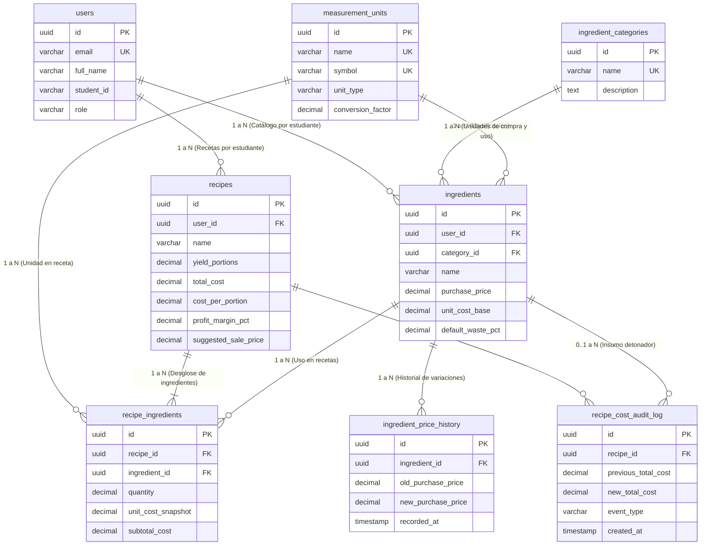
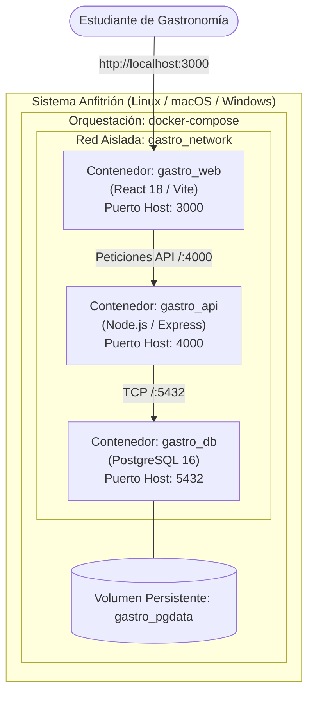

# Especificación de Diseño de Software (SDS) — Arquitectura Base
## GastroProyect — Sistema de Costeo y Precios de Venta Gastronómicos

| Metadato | Detalle |
| :--- | :--- |
| **Documento** | Especificación de Diseño de Software (SDS) — Arquitectura y Persistencia |
| **Proyecto** | GastroProyect |
| **Equipo** | Morelosoft International Solutions |
| **Institución** | Universidad Autónoma de Zacatecas (UAZ) |
| **Estándar** | ISO/IEC 29110-5-1-1:2025 |
| **Responsable** | Carlos Manuel Aguirre Norato (Líder Técnico) |
| **Revisores** | Karol Christopher Espino Galicia (Líder de Equipo), Héctor Varela Medina (Calidad) |
| **Versión** | 0.1.0 (Arquitectura Inicial Base) |

---

## 1. Propósito y Alcance del Documento
El propósito de esta especificación es formalizar la **arquitectura técnica base** y el **modelo de datos relacional** que sustentarán el desarrollo de la herramienta **GastroProyect**. 

Conforme al hito actual del proyecto (Sprint 0 / Arranque), este documento delimita la estructura arquitectónica fundamental, la topología de contenedores Docker, la conectividad y el diseño de la base de datos local, sirviendo como contrato técnico de referencia previo a la implementación de las reglas de negocio del Sprint 1.

---

## 2. Decisión Arquitectónica Principal
1. **Patrón Arquitectónico:** Arquitectura Cliente-Servidor Desacoplada (Three-Tier Architecture).
2. **Contenerización Total (Docker Compose):** Todos los componentes (Base de Datos, API Backend y SPA Frontend) se ejecutan en contenedores coordinados dentro de una red bridge dedicada (`gastro_network`), eliminando dependencias del sistema operativo anfitrión.
3. **Persistencia Transaccional:** Motor relacional **PostgreSQL 16 Alpine** con volumen Docker nombrado (`gastro_pgdata`) y scripts DDL automáticos montados como solo lectura (`/docker-entrypoint-initdb.d:ro`).

---

## 3. Diagrama de Arquitectura de Componentes

```mermaid
graph TB
    subgraph FrontendSPA["Capa de Presentación: Frontend SPA (React 18 + Vite)"]
        UI["Vistas & Layout Base (Tailwind CSS)"]
        Components["Componentes Modulares & Tableros"]
        ApiClient["Cliente HTTP Centralizado (api.js)"]

        UI --> Components
        Components --> ApiClient
    end

    subgraph BackendAPI["Capa de Negocio: Backend REST API (Node.js + Express)"]
        Router["Enrutador REST (/api)"]
        Controllers["Controladores HTTP & Validación"]
        Services["Lógica de Negocio & Algoritmos de Costeo"]
        ConfigDB["Pool de Persistencia PostgreSQL (pg pool)"]

        Router --> Controllers
        Controllers --> Services
        Services --> ConfigDB
    end

    subgraph DatabaseLayer["Capa de Datos: Base de Datos Relacional (PostgreSQL 16)"]
        Tables["Esquema Normalizado 3NF (8 Tablas Principales)"]
        Seeds["Datos Semilla (Unidades Culinarias & Categorías)"]
        Audit["Logs de Trazabilidad y Cascada"]

        Tables --- Seeds
        Tables --- Audit
    end

    ApiClient -->|Peticiones HTTP REST / JSON (Puerto 4000)| Router
    ConfigDB -->|Conexión SQL / TCP Pool (Puerto 5432)| Tables
```

---

## 4. Diagrama de Persistencia (Modelo Relacional ERD)



---

## 5. Topología de Despliegue y Orquestación



---

## 6. Verificación de Conformidad y Estado de Entrega
- **Base de Datos Local:** Implementada en PostgreSQL 16 con DDL y datos semilla iniciales.
- **Backend API:** Implementado con pool de conexión, verificación de latencia y healthcheck.
- **Frontend SPA:** Implementado con panel de control de arquitectura y monitoreo en tiempo real.
- **Trazabilidad ISO/IEC 29110:** 100% de cobertura entre Requerimientos, CUs, Tablas de BD y Endpoints.
