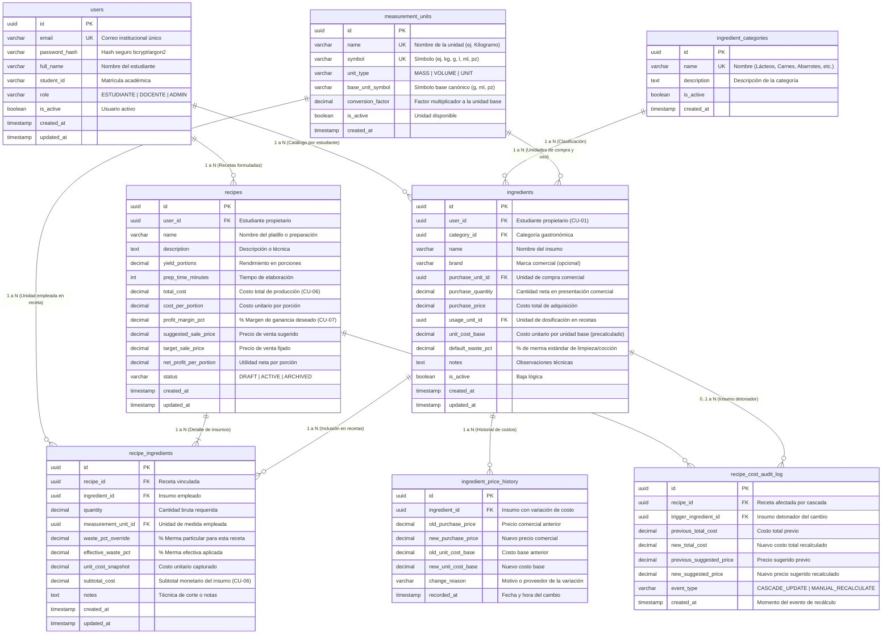

# Especificación y Diseño de Base de Datos Relacional (ERD) — GastroProyect
## Sistema de Administración de Insumos y Costeo Gastronómico

| Metadato | Detalle |
| :--- | :--- |
| **Documento** | Especificación Formal de Base de Datos y Diagrama Entidad-Relación (ERD) |
| **Proyecto** | GastroProyect — Automatización de Costos y Precios de Venta Gastronómicos |
| **Equipo** | Morelosoft International Solutions |
| **Estándar** | ISO/IEC 29110-5-1-1:2025 (Perfil Básico / Entrada para VSEs) |
| **Motor de BD** | PostgreSQL 16 Alpine (Contenerizado con Docker Compose) |
| **Responsable** | Carlos Manuel Aguirre Norato (Líder Técnico) |
| **Revisores** | Karol Christopher Espino Galicia (Líder de Equipo), Héctor Varela Medina (Calidad) |
| **Fecha** | 20 de Octubre de 2026 |
| **Versión** | 1.0.0 (Línea Base Sprint 0) |

---

## 1. Diagrama Entidad-Relación (Mermaid ERD)

El siguiente modelo relacional en Tercera Forma Normal (3NF) estructura la persistencia del sistema, garantizando la segregación de catálogos por estudiante, estandarización de unidades culinarias, soporte de mermas y auditoría de variaciones de costos en cascada:

---

## 2. Diccionario de Datos y Reglas de Integridad

### 2.1 `users` (Gestión de Cuentas y Seguridad — CU-01)
- **`id` (UUID, PK):** Identificador universal autogenerado (`gen_random_uuid()`).
- **`email` (VARCHAR(255), UNIQUE):** Correo institucional del estudiante o docente.
- **`password_hash` (VARCHAR(255)):** Hash criptográfico unidireccional.
- **`full_name` (VARCHAR(150)):** Nombre completo del alumno.
- **`student_id` (VARCHAR(50)):** Matrícula académica para fines de evaluación docente.
- **`role` (VARCHAR(30)):** Rol con restricción `CHECK (role IN ('ESTUDIANTE', 'DOCENTE', 'ADMIN'))`.
- **`is_active` (BOOLEAN):** Indicador de cuenta activa.

### 2.2 `measurement_units` (Estandarización y Conversiones Culinarias)
Mitiga directamente el riesgo `R-02` establecido en el Plan de Proyecto (inconsistencias por compras en kg/litros y uso en g/ml):
- **`id` (UUID, PK):** Identificador de la unidad.
- **`symbol` (VARCHAR(10), UNIQUE):** Notación estándar (`kg`, `g`, `l`, `ml`, `tz`, `cda`, `pz`).
- **`unit_type` (VARCHAR(20)):** Clasificación dimensional `CHECK (unit_type IN ('MASS', 'VOLUME', 'UNIT'))`.
- **`base_unit_symbol` (VARCHAR(10)):** Símbolo canónico (`g` para masa, `ml` para volumen, `pz` para piezas).
- **`conversion_factor` (DECIMAL(14,6)):** Factor multiplicador para convertir a la unidad base:
  $$\text{Cantidad en Unidad Base} = \text{Cantidad Ingresada} \times \text{conversion\_factor}$$

### 2.3 `ingredient_categories` (Categorización de Materias Primas)
- **`id` (UUID, PK):** Identificador de categoría.
- **`name` (VARCHAR(100), UNIQUE):** Grupos gastronómicos estandarizados (Lácteos, Carnes, Frutas y Verduras, Granos y Harinas, Especias, Grasas, etc.).

### 2.4 `ingredients` (Catálogo Maestro de Insumos — CU-02, CU-03)
- **`id` (UUID, PK):** Identificador único del insumo.
- **`user_id` (UUID, FK):** Referencia a `users(id)` con `ON DELETE CASCADE`. Asegura que cada alumno sea dueño de su catálogo privado (modelo B2C académico).
- **`purchase_quantity` / `purchase_price` (DECIMAL):** Presentación comercial en la que el estudiante adquiere el insumo (ej. Bolsa de 1 kg a \$38.00 MXN).
- **`unit_cost_base` (DECIMAL(14,6)):** Costo por unidad de uso normalizada.
- **`default_waste_pct` (DECIMAL(5,2)):** Porcentaje de merma estándar del ingrediente (ej. 20% cáscara de papa o merma por descongelación de carne).
- **Restricción de Unicidad:** `CONSTRAINT uq_user_ingredient_name UNIQUE (user_id, name)`.

### 2.5 `recipes` (Recetas y Productos Formulados — CU-04, CU-05, CU-06, CU-07)
- **`id` (UUID, PK):** Identificador de la receta.
- **`yield_portions` (DECIMAL(8,2)):** Porciones netas obtenidas de la preparación (default `1.00`).
- **`total_cost` (DECIMAL(12,4)):** Sumatoria automatizada de los subtotales de insumos (CU-06).
- **`cost_per_portion` (DECIMAL(12,4)):** $\frac{\text{total\_cost}}{\text{yield\_portions}}$.
- **`profit_margin_pct` (DECIMAL(5,2)):** Margen de ganancia fijado por el usuario (CU-07).
- **`suggested_sale_price` (DECIMAL(12,4)):** Precio sugerido calculado con base en el margen.
- **`target_sale_price` (DECIMAL(12,4)):** Precio de venta definitivo acordado.
- **`net_profit_per_portion` (DECIMAL(12,4)):** Utilidad neta calculada por porción.

### 2.6 `recipe_ingredients` (Formulación Detallada de Insumos — CU-04, CU-06, CU-09)
- **`recipe_id` (UUID, FK) & `ingredient_id` (UUID, FK):** Relación de muchos a muchos con clave única compuesta (`UNIQUE (recipe_id, ingredient_id)`).
- **`effective_waste_pct`:** Merma efectiva aplicada a la receta.
- **`unit_cost_snapshot`:** Instantánea del costo unitario al momento del costeo.
- **`subtotal_cost`:** Costo monetario proporcional calculado para esta receta.

### 2.7 `ingredient_price_history` & `recipe_cost_audit_log` (Trazabilidad y Cascada — CU-08, CU-09)
- Registran de forma inmutable cada variación de precio y cada recálculo automático en cascada de las recetas impactadas, garantizando una auditoría 100% trazable según la norma ISO/IEC 29110.

---

## 3. Fórmulas Matemáticas y Reglas de Negocio de Costeo

### 3.1 Cálculo del Costo Unitario Base del Insumo
Dado un precio de compra $P_{compra}$, una cantidad de presentación $Q_{presentacion}$ y el factor de conversión $F_{compra}$ hacia la unidad base:
$$\text{Cantidad Base} = Q_{presentacion} \times F_{compra}$$
$$\text{Costo Unitario Base} = \frac{P_{compra}}{\text{Cantidad Base}}$$

### 3.2 Cálculo del Costo Proporcional con Merma Culinaria en Receta
Para un insumo en receta con cantidad bruta $Q_{receta}$, factor de conversión $F_{receta}$, costo unitario base $C_{base}$ y merma efectiva $M_{\%} \in [0, 100)$:
$$\text{Cantidad Base Requerida} = Q_{receta} \times F_{receta}$$
$$\text{Factor de Rendimiento} = 1 - \frac{M_{\%}}{100}$$
$$\text{Subtotal del Insumo} = \frac{\text{Cantidad Base Requerida} \times C_{base}}{\text{Factor de Rendimiento}}$$

### 3.3 Costo Total de Producción y Costo por Porción (CU-06)
$$\text{Costo Total de Receta} = \sum_{i=1}^{n} \text{Subtotal Insumo}_{i}$$
$$\text{Costo por Porción} = \frac{\text{Costo Total de Receta}}{\text{Rendimiento en Porciones}}$$

### 3.4 Cálculo del Precio de Venta Sugerido (CU-07)
Dado el margen de ganancia comercial deseado $MG_{\%} \in [0, 100)$:
$$\text{Precio de Venta Sugerido por Porción} = \frac{\text{Costo por Porción}}{1 - \frac{MG_{\%}}{100}}$$
$$\text{Utilidad Neta por Porción} = \text{Precio de Venta Sugerido por Porción} - \text{Costo por Porción}$$
